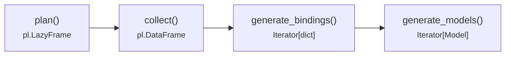

# The pipeline

`ModelMaterializer` exposes every stage between your data and your models, so you can stop
wherever is most useful: inspect the query plan, hand a `DataFrame` to another tool, or
stream validated objects.



| Method                | Returns                   | Use it to…                                            |
|-----------------------|---------------------------|-------------------------------------------------------|
| `plan()`              | `pl.LazyFrame`            | inspect or extend the query before it runs            |
| `collect()`           | `pl.DataFrame`            | get nested results as a dataframe, e.g. for Parquet   |
| `generate_bindings()` | `Iterator[dict]`          | get plain nested dicts, without validation            |
| `generate_models()`   | `Iterator[Model]`         | get validated Pydantic objects                        |

## Input data

`data` accepts anything Polars can turn into a frame: a list of dicts, a dict of columns,
a `pl.DataFrame`, and so on. A `pl.LazyFrame` is used as-is, so `graphty`'s plan is simply
added on top of your existing lazy query, for example a lazily scanned file:

```python
lazy_rows = pl.scan_parquet("works.parquet")
authors = ModelMaterializer(model=Author, data=lazy_rows).generate_models()
```

## Looking under the hood

`plan()` shows exactly what `graphty` compiled from your models: one `group_by`/`agg`
with nested struct expressions, and no Python loops.

```python
>>> print(ModelMaterializer(model=Author, data=rows).plan().explain())
AGGREGATE[maintain_order: true]
  [col("born").first(), col("title").first().over([col("title")]).as_struct([col("year").first().over([col("title")]), col("genre").unique().drop_nulls().implode().over([col("title")])]).alias("works").unique().drop_nulls()] BY [col("author")]
  FROM
  DF ["author", "born", "title", "year", ...]; PROJECT["born", "title", "year", "genre", ...] 5/5 COLUMNS
```

`collect()` runs the plan on Polars' streaming engine:

```python
>>> ModelMaterializer(model=Author, data=rows).collect()
shape: (2, 3)
┌─────────┬──────┬─────────────────────────────────┐
│ author  ┆ born ┆ works                           │
│ ---     ┆ ---  ┆ ---                             │
│ str     ┆ i64  ┆ list[struct[3]]                 │
╞═════════╪══════╪═════════════════════════════════╡
│ Tolkien ┆ 1892 ┆ [{"The Hobbit",1937,["fantasy"… │
│ Orwell  ┆ 1903 ┆ [{"Animal Farm",1945,["satire"… │
└─────────┴──────┴─────────────────────────────────┘
```

!!! note "Bindings use column names"

    Bindings are keyed by **source column names** (`author`, `genre`), which Pydantic then maps
    to field names through your aliases. This is why `generate_models()` validates them correctly.

## Debug logging

`generate_models()` logs every binding before validation at `DEBUG` level, which helps when
a model fails to validate:

```python
import logging

logging.basicConfig()
logging.getLogger("graphty").setLevel(logging.DEBUG)
```
